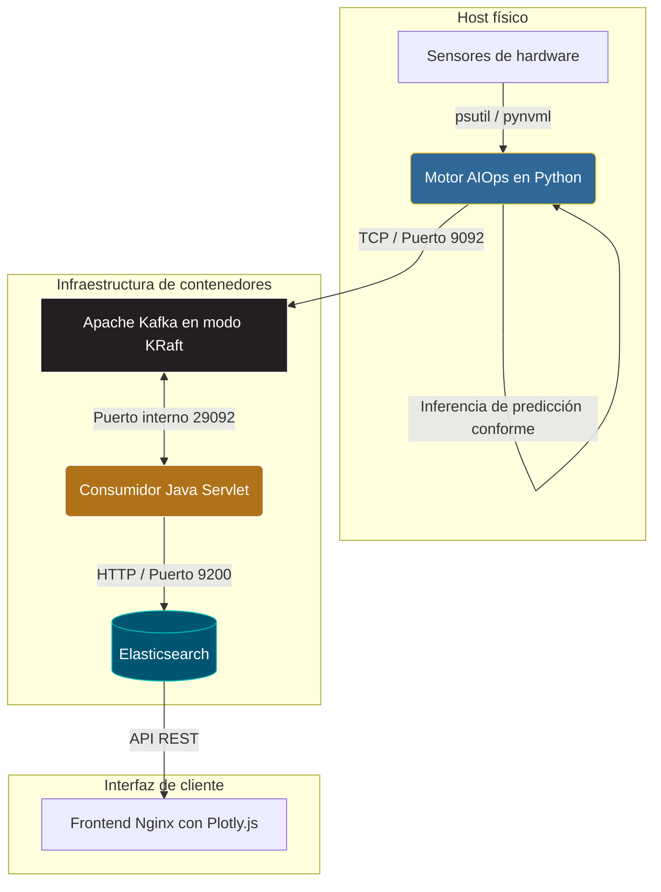
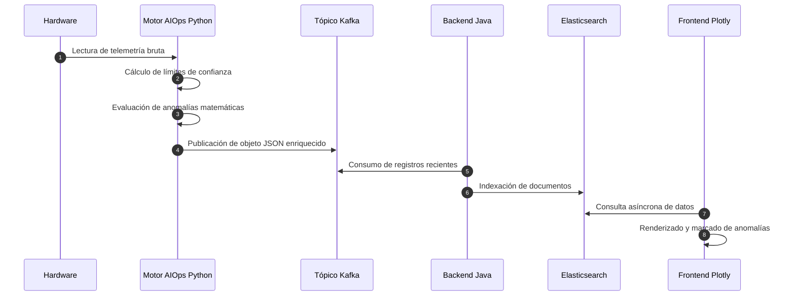

# Sistema de telemetría predictiva y AIOps

Este repositorio contiene la implementación completa de un sistema de telemetría de hardware asistido por inteligencia artificial. La arquitectura está diseñada para capturar métricas físicas en tiempo real, calcular márgenes de confianza estocásticos en el origen y distribuir los datos a través de una infraestructura de eventos para su posterior indexación y visualización.

## Arquitectura del sistema

El diseño del sistema aplica un modelo de separación de responsabilidades, dividiendo la extracción de datos físicos a nivel de sistema operativo y la gestión de la información en un entorno aislado de contenedores.

## Flujo de datos y secuencia

El ciclo de vida del dato comienza en el borde de la red y atraviesa los distintos servicios hasta llegar a la interfaz de usuario. El siguiente diagrama detalla la interacción asíncrona entre los componentes.

## Decisiones de arquitectura e ingeniería

El desarrollo de este sistema responde a tres criterios técnicos fundamentales enfocados en la escalabilidad y la tolerancia a fallos:

* Desacoplamiento mediante flujo de eventos: Se ha implementado Apache Kafka operando en modo KRaft como bus de integración central. Esta decisión garantiza que si el motor de indexación de Elasticsearch sufre latencia o caídas, Kafka retiene la telemetría en disco. El productor en Python actúa de forma independiente y nunca se bloquea por problemas en la base de datos.
* Modelado predictivo seguro: A diferencia de los sistemas tradicionales basados en umbrales estáticos, este proyecto aplica técnicas de predicción conforme directamente en la fase de captura. Esto permite adjuntar límites de confianza matemáticos al propio mensaje de telemetría antes de enviarlo por la red, facilitando a la interfaz gráfica la representación de bandas de incertidumbre precisas.
* Inyección dinámica de entorno: El consumidor desarrollado en Java está diseñado bajo principios de aplicaciones nativas de la nube. La resolución de direcciones y puertos se determina en tiempo de ejecución, lo que permite que el código funcione sin modificaciones tanto en un entorno local de desarrollo como en una red cerrada de contenedores en producción.

## Guía de instalación y despliegue

Para inicializar el sistema completo es necesario levantar la infraestructura de almacenamiento y posteriormente iniciar el motor de captura de datos físicos.

1. Inicialización de la infraestructura:
Levante los servicios contenerizados de Kafka, Elasticsearch, Backend Java y Frontend Nginx mediante el orquestador.
`docker-compose up -d`

2. Arranque del recolector de telemetría:
Ejecute el motor matemático directamente sobre la máquina host para garantizar el acceso de lectura a los sensores físicos del hardware.
`cd aiops-engine`
`pip install -r requirements.txt`
`python aiops_engine.py`

3. Acceso al panel de control:
Una vez que los servicios estén operando y el motor de Python comience a publicar mensajes, acceda mediante un navegador web a la dirección local en el puerto 3000 (http://localhost:3000) para visualizar el panel de métricas y anomalías en tiempo real.